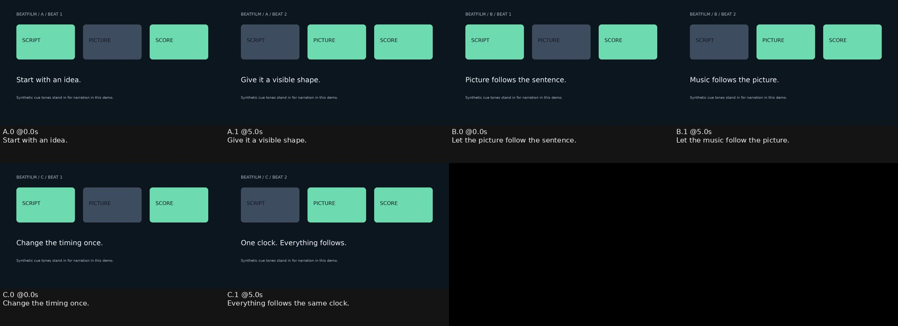

# Beatfilm

A small narration-driven video toolkit extracted from **Three Voids**, a published video essay about a painting, Minecraft and an empty AI prompt.

A script is split into shots and picture beats (` | `). One set of measured timings drives cuts, animated highlights and score cues. Keep the editorial decisions in project files; automate rendering, audio preparation and review exports.

## Run the 30-second example

Linux, Python 3.12 (tested), FFmpeg/ffprobe with libx264, and DejaVu Sans are required. FFmpeg must include the `rubberband` filter for time-stretched dubs. NVIDIA hardware is optional. The demo needs no network, model, sample library, browser or external artwork after dependency installation.

```sh
python3 -m venv .venv
. .venv/bin/activate
pip install -r requirements-lock.txt
python beatfilm.py demo
python beatfilm.py assemble --guide
python beatfilm.py review examples/demo/out/review.jpg A B C
```

Outputs live in `examples/demo/out/`: `film-final.mp4`, `film-guide.mp4`, `timeline.json`, `mix-report.txt` and the review image. The demo uses synthetic cue tones **in place of spoken narration**. It demonstrates synchronized pictures and music, not speech recognition quality. Its three ten-second scenes contain six beats. Frames are 1920×1080 at 60 fps.

Change a pair of beat lengths in `examples/demo/build/timings.json`, run `demo` again, then `assemble --guide --reuse`. The picture cue and bell move with the beat. Reused segments are checked by content, so changed inputs trigger a rebuild. Invalidation is conservative: an input change may rebuild all shots.



## Use your own project

Copy `examples/demo` to a new directory, excluding `out`, `.cache` and generated `narration`. Run tools with `python beatfilm.py --project /path/to/project TOOL ...`.

- `project.json`: encoder (`libx264` or `h264_nvenc`), optional alignment overrides.
- `build/narration.py`: ordered `NARR = [(shot_id, "spoken text | next beat"), ...]`, and `FIXED` durations for silent shots.
- `build/edl.py`: `EDL` maps shot IDs to picture parts; `EXTRA` adds holds after speech. A part's `b` anchors its start to a fractional beat.
- `build/timings.json`: `{shot_id: [beat_duration, ...]}` in seconds. Exact beat timings take precedence over recordings and estimates.
- `tools/gfx/render.py`: project-specific renderer; receives scene ID, `--dur`, `--out`, named `--set key=SECONDS` cues and optional `--json` keyframes. The demo provides a small implementation.
- `narration/SHOT.wav`: mono 48 kHz narration. `assets`, `raw`, `stills`, `clips`: project-owned source media.

EDL part kinds retained from production: video (default), `still`, `black`, `split`, `gfxr`, `cam` and `map`. Game video defaults to a centre crop of 2560×1080; set `crop="none"` for 1920×1080 inputs. `cam` and `map` require the corresponding project renderer; the original implementations are in the case study. `score/engine.py` contains sampled piano, synthesis, reverb, tape and mixing primitives. `BEATFILM_SAMPLES` selects an external sample-library directory. The sampler supports a subset of SFZ, not the full standard.

## Narration, captions and dubbing

```sh
pip install -r requirements-transcribe.txt
# Convert your recording to mono 16 kHz before transcription.
ffmpeg -i recording.wav -ar 16000 -ac 1 voice16k.wav
python beatfilm.py --project PROJECT transcribe voice16k.wav PROJECT/narration/words.json en
python beatfilm.py --project PROJECT align recording.wav --runs
python beatfilm.py --project PROJECT align recording.wav
python beatfilm.py --project PROJECT assemble --guide
python beatfilm.py --project PROJECT verify_narration
```

Speech transcription downloads faster-whisper model weights on first use. Default models are `medium.en` for English and `medium` for other languages. Record shots in script order, with retakes after mistakes. The aligner prefers the last sufficiently complete reading, trims long pauses, levels clips, and writes measured beat timings. Inspect `narration/alignment-report.txt` and listen to selected takes. `--no-refine` skips the second transcription pass. `project.json` can set `"alignment_starts": {"en": {"SHOT": 123.4}}` for source-time start overrides. A complete retake can still be artistically worse than an earlier take; automatic selection is a starting point.

For word-timed English captions, transcribe the **finished audio** into `PROJECT/.cache/tmp/final_words.json`, then run `captions`. It retains the script's spelling. `verify_narration` compares a new transcription of the edited clips with the script; differences are review signals.

For another language, provide `build/narration_LANG.py` with `NARR_LANG`, using the same shot and beat structure; transcribe into `narration/words-LANG.json`, run `align recording.wav --lang LANG`, then `dub LANG`. Dubbing compresses pauses before applying pitch-preserving tempo changes (maximum 1.13×). It fails if speech still cannot fit, so shorten or rerecord the passage. It uses the existing picture timeline and score. The original Russian subtitle/reading-sheet generator is preserved in the case study, but has not been generalized here.

`mix VOICE.wav MUSIC.wav OUTPUT.wav` balances music beneath voice and prints measured loudness/true peak. The production defaults are starting points, not delivery guarantees. Listen to the result and measure the encoded file when a platform has exact requirements.

## Verification

```sh
python -m unittest discover -s tests -v
python tests/integration.py
```

Unit checks exercise retake selection, missing transcript failure, invalid beat lengths and content-based invalidation. The integration check renders the demo, checks duration/video/audio streams, generates a review sheet, checks reuse, then changes a cue while preserving scene duration and verifies that the rendered frame changes. It also exercises a dub with synthetic voice placeholders.

See [process lessons](docs/process.md), [provenance and assets](PROVENANCE.md), and [the original production source](examples/three-voids-source/CASE-STUDY.md). This is a compact extraction with project-specific renderers, not a general nonlinear editor. Project Python files are trusted executable code; don't run unfamiliar projects without reviewing them.

For an original score, `score/cues.py` exposes `CueTimeline("PROJECT/out/timeline.json")`: `at("SHOT", beat=1.5, offset=0.1)` and `end("SHOT")` resolve against the actual rendered picture. Render picture first, compose using those cues, write `out/film-score.wav`, then assemble again with `--reuse`. The six-note demo is deliberately much simpler than the film's composition.
